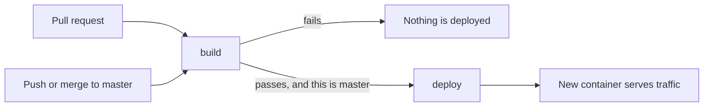
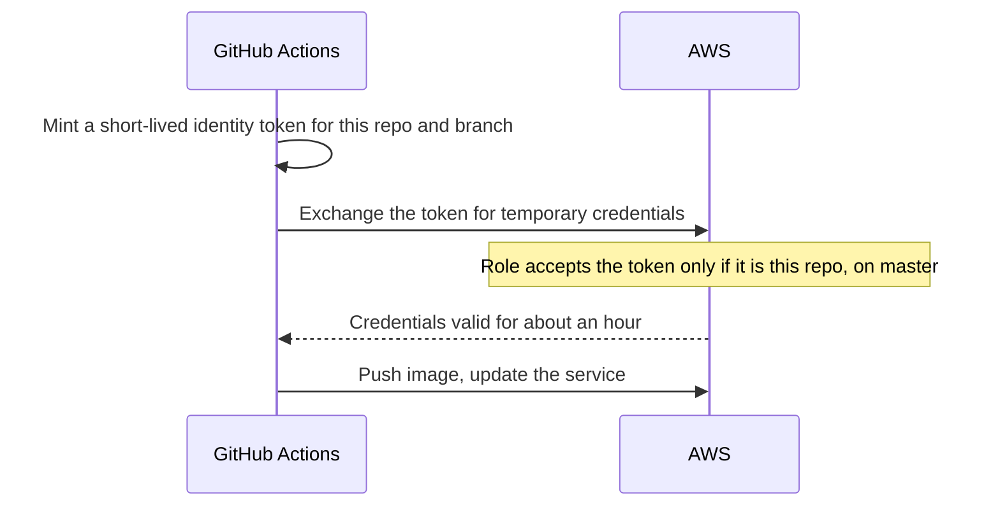
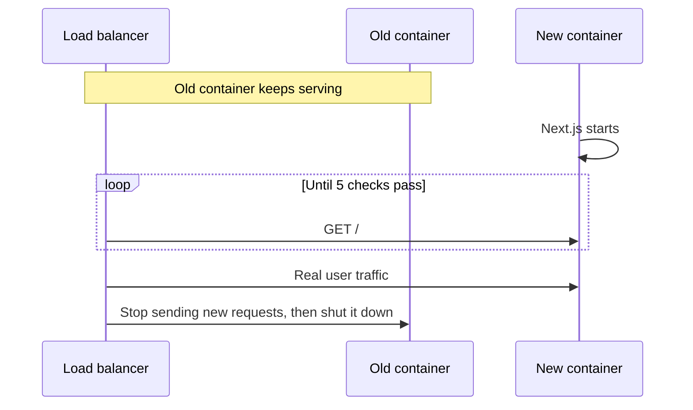

# CI and deploys

What happens when you push this repo, and why each part exists. The workflow is [.github/workflows/ci.yaml](.github/workflows/ci.yaml). How the app is hosted is in [DEPLOYMENT.md](DEPLOYMENT.md).

## What it does

Two jobs:

- **build** checks that the app compiles. It runs on every pull request and every push to `master`.
- **deploy** ships that commit to the live site. It runs only after `build` succeeds, and only on a push to `master` (a merge counts as a push).

A pull request never reaches AWS. A broken build never replaces the running site.

## Why it logs in the way it does

The deploy job needs to push an image and update ECS. It does that as the IAM role `url-shortener-github-deploy`, without an AWS access key stored in GitHub.

GitHub includes its permanent account and repo IDs in that token. The role trusts that exact identity, so a different repo, or a repo recreated under the same name, cannot deploy.

The job also logs in to Docker Hub. That login is only for downloading the base image (`dhi.io/node`) while building. The finished image goes to ECR.

## The build job

Runs on a clean GitHub-hosted machine.

| Step | Why |
| --- | --- |
| Check out the repo | The runner starts empty. |
| Install pnpm and Node 24 | Same package manager and Node version as local development. |
| `pnpm install --frozen-lockfile` | Installs exactly the versions in the lockfile. A drift between `package.json` and the lockfile fails the job. |
| `pnpm build` | Proves this commit compiles. The deploy job will not start if this fails. |

This job does not run tests or lint. A commit that compiles but fails tests still deploys.

## The deploy job

Starts only when `build` passed and the event is a push to `master`. One deploy runs at a time; a second merge waits instead of interrupting the first. Stopping a deploy halfway can leave ECS between two versions.

| Step | Why |
| --- | --- |
| Check out the repo | The image is built from this commit. |
| Assume the AWS role | Gives the job permission to push to one ECR repository and update one ECS service, for about an hour. |
| Log in to ECR | The registry that Fargate pulls images from. |
| Log in to Docker Hub | So the build can download the `dhi.io` base image. |
| Set up Buildx | Docker's build engine. The Dockerfile uses it for dependency caching, and it reuses layers from the previous run so later builds are faster. |
| Build and push the image | Builds for `linux/amd64`, which is what Fargate runs. Pushes two tags: the commit SHA (the one that gets deployed) and `latest` (a convenience pointer). |
| Read the current task definition | The task definition is the recipe ECS runs: CPU, memory, secrets, port. Only the image should change. |
| Register a new revision | A copy of that recipe whose image is this commit's SHA. Secrets and everything else stay as they are. |
| Update the ECS service and wait | ECS starts a new container from that revision, waits until the load balancer calls it healthy, then stops the old one. The job stays running until that finishes. |

## How the site actually changes

There is no cache to clear. The load balancer sends traffic to whichever container is healthy.

With the current health checks (every 30 seconds, 5 passes required), the new version takes a few minutes to receive traffic. Until then the previous version keeps serving, so a deploy does not take the site down.

If the new container never becomes healthy, the service rolls back to the previous task definition and the GitHub job fails. Each commit is its own image and its own task definition revision, so you can also roll back by pointing the service at an older revision.

## One-time setup

Already done for this repo, listed so it is clear what the workflow depends on:

- An IAM identity provider for GitHub, and the role `url-shortener-github-deploy` that trusts this repo's `master` branch.
- Two GitHub Actions secrets: `DOCKER_USERNAME` and `DOCKER_TOKEN` (a read-only Docker Hub token). The workflow fails at the image build without them.

## What you do day to day

1. Open a pull request. The **build** job runs. Fix it if it fails.
2. Merge to `master`. **build** runs again, then **deploy**.
3. Watch the run under the repo's **Actions** tab. The site is on the new version when the **Deploy to ECS** step goes green.
