# Deploying url-shortener to AWS

How this app runs on AWS, what every piece does and why it's needed, and how to set it up. Every step has console instructions and the equivalent AWS CLI commands; use whichever you prefer.

Stack: **ECS Fargate** (runs the container) + **Application Load Balancer** (public entry point, HTTPS) + **RDS PostgreSQL** (database) + **ECR** (image storage) + **Secrets Manager** (database URL) + **IAM** (permissions) + **CloudWatch** (logs) + **Route 53** and **ACM** (domain and certificate).

- Region: `eu-central-1` (Frankfurt)
- Domain: `frontdev-testing3.click`

---

## Part 1: The big picture

### What the app needs to run

Locally, `docker compose up` gives you a container running Next.js and a container running Postgres, both on your laptop and able to talk to each other. On AWS you need the same two things, plus everything your laptop gave you for free:

| Your laptop gave you | On AWS you need |
| --- | --- |
| A computer to run the container | **ECS Fargate** |
| The image, built right there | **ECR**: a place to upload the image so AWS can download it |
| `localhost:3000` in the browser | **Application Load Balancer**: a public address that forwards to the container |
| Postgres in a container | **RDS**: a managed Postgres server |
| `DATABASE_URL` in `.env` | **Secrets Manager**: stores the URL so it's not baked into the image |
| Nothing is reachable from outside | **VPC, subnets, security groups**: the network and its firewalls |
| You are admin of everything | **IAM**: AWS asks "who is allowed to do this?" for every action |
| Logs in your terminal | **CloudWatch Logs**: where container output goes |
| `localhost` as the name | **Route 53** (domain and DNS) and **ACM** (HTTPS certificate) |

### How it all connects

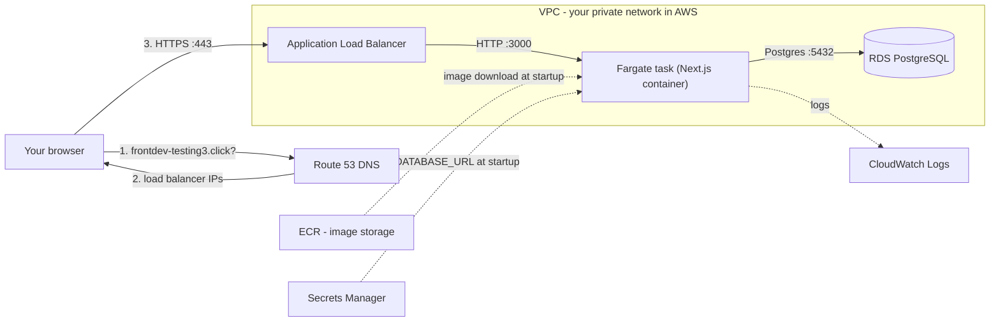

Solid lines happen on every request. Dotted lines happen when a container starts (or continuously, for logs).

### What happens when someone opens a short link

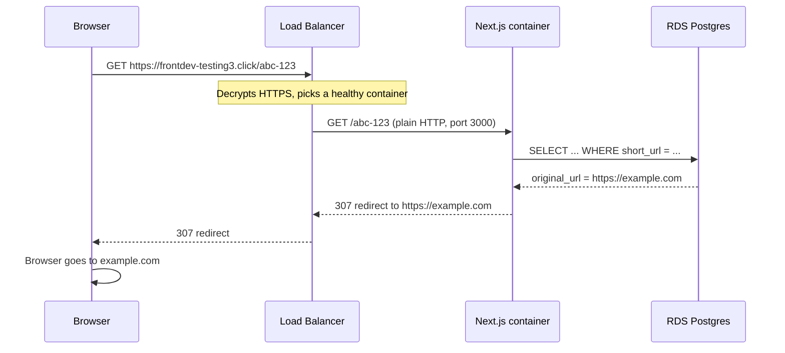

---

## Part 2: Networking basics (read this once)

Most deployment problems are networking problems. These are the concepts this app uses.

### VPC (Virtual Private Cloud)

A private network inside AWS, like your home Wi-Fi network but in a data center. The load balancer, containers and database all live in **one VPC**, and can talk to each other using private IPs if the firewalls allow it.

Your account has a **default VPC** (`172.31.0.0/16`, all addresses from `172.31.0.0` to `172.31.255.255`). This app uses it.

### Subnets and Availability Zones

A VPC is split into **subnets**, smaller address ranges. Each subnet lives in one **Availability Zone (AZ)**, a physically separate data center in the region (`eu-central-1a`, `1b`, `1c`). Spreading across AZs means one data center failing doesn't take the app down, which is why the load balancer requires at least 2 subnets.

- A **public subnet** has a route to the internet through an **Internet Gateway**. Things in it can have a public IP, reach the internet, and be reached from it (if their firewall allows).
- A **private subnet** has no direct internet route. Things in it can only reach out through a **NAT Gateway** (about $32 a month).

Your default VPC has three public subnets, one per AZ. This app uses those and no NAT Gateway.

### Security groups (the important one)

A **security group** is a firewall attached to a resource. It lists which **incoming** traffic is allowed: which port, and from where. Everything else is blocked. Outgoing traffic is allowed by default.

The "from where" (the **source**) can be:

- **An IP range** in CIDR notation: `0.0.0.0/0` is the whole internet, `85.221.129.164/32` is exactly one IP.
- **Another security group**: "allow port 3000 from `url-shortener-alb-sg`" means "allow anything that has the load balancer's security group attached". You don't need to know its IPs, which change.

Picking the wrong source is the most common mistake. If the load balancer's port 443 rule has `url-shortener-alb-sg` as its source instead of `0.0.0.0/0`, only the load balancer itself may connect, and every browser times out.

This app uses a chain of three security groups, so each layer can only be reached by the layer in front of it:

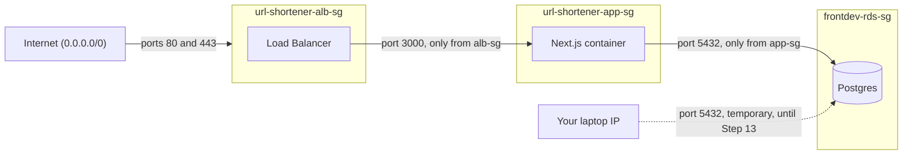

The internet can reach the load balancer and nothing else. Nobody can bypass the load balancer to hit the container, and only the container (plus your laptop, for now) can reach the database.

### Ports used by this app

| Port | What | Between |
| --- | --- | --- |
| 80 | HTTP (only redirects to 443) | Browser to load balancer |
| 443 | HTTPS | Browser to load balancer |
| 3000 | Next.js server | Load balancer to container |
| 5432 | PostgreSQL | Container (and your laptop) to RDS |

### ARN (Amazon Resource Name)

Every AWS resource has a unique ID called an ARN, like `arn:aws:secretsmanager:eu-central-1:<account-id>:secret:prod/UrlShortener-Cp3Q5W`. You use ARNs to tell one service which resource of another service to use.

---

## Part 3: Using the AWS CLI

You can do every step in the console, the CLI, or a mix. The CLI commands below are written for **Git Bash on Windows** and work the same on macOS/Linux.

### One-time install

1. Install [AWS CLI v2](https://docs.aws.amazon.com/cli/latest/userguide/getting-started-install.html).
2. Run `aws configure` and enter an access key (**IAM > Users > your user > Security credentials > Create access key**), region `eu-central-1`, output `json`.
3. Check it works: `aws sts get-caller-identity` prints your account ID.

### Start of every terminal session

The steps save IDs into shell variables (`$ALB_SG`, `$TG_ARN`...) so later commands can use them. Variables disappear when you close the terminal, so paste this block first in every new terminal:

```bash
# Git Bash rewrites arguments starting with "/" into Windows paths; this turns that off (breaks /ecs/... otherwise)
export MSYS_NO_PATHCONV=1
# Print output directly instead of opening a pager
export AWS_PAGER=""
# Lets the CLI print the Next.js logo characters in logs on Windows
export PYTHONUTF8=1
export AWS_DEFAULT_REGION=eu-central-1

APP=url-shortener
ALB_NAME=url-shortener-alb       # use your load balancer's actual name if it differs
DOMAIN=frontdev-testing3.click
RDS_ID=url-shortener

ACCOUNT_ID=$(aws sts get-caller-identity --query Account --output text)
ECR_URI=$ACCOUNT_ID.dkr.ecr.$AWS_DEFAULT_REGION.amazonaws.com/$APP
VPC_ID=$(aws rds describe-db-instances --db-instance-identifier $RDS_ID --query "DBInstances[0].DBSubnetGroup.VpcId" --output text)
SUBNETS_CSV=$(aws ec2 describe-subnets --filters Name=vpc-id,Values=$VPC_ID Name=default-for-az,Values=true --query "join(',', Subnets[].SubnetId)" --output text)
RDS_SG=$(aws rds describe-db-instances --db-instance-identifier $RDS_ID --query "DBInstances[0].VpcSecurityGroups[0].VpcSecurityGroupId" --output text)
```

If resources already exist (from a previous session), also run the lookup block in [Appendix A](#appendix-a-look-up-existing-resources).

---

## Part 4: Step by step

In the console, always check the region selector (top right) says **Europe (Frankfurt)**. Resources in other regions are invisible.

### Step 0: Prepare locally

**Why:** the image is built and pushed from your machine, and the database tables must exist before the app can use them.

1. Log in to the Docker Hardened Images registry. The [Dockerfile](Dockerfile) builds from `dhi.io` images, which require it:

   ```bash
   docker login dhi.io
   ```

2. Get the database address: **RDS > Databases > `url-shortener` > Connectivity & security > Endpoint**, or:

   ```bash
   aws rds describe-db-instances --db-instance-identifier $RDS_ID --query "DBInstances[0].Endpoint.Address" --output text
   ```

3. Allow your laptop to reach the database: in **EC2 > Security Groups > `frontdev-rds-sg` > Inbound rules > Edit inbound rules**, add type **PostgreSQL**, source **My IP**. Or:

   ```bash
   MY_IP=$(curl -s https://checkip.amazonaws.com)
   aws ec2 authorize-security-group-ingress --group-id $RDS_SG --protocol tcp --port 5432 --cidr $MY_IP/32
   ```

   Your home IP changes from time to time. When `psql` or migrations start timing out, run this again.

4. Create the tables: put the RDS URL in `.env` and run the migrations.

   ```
   DATABASE_URL=postgresql://<user>:<password>@<endpoint>:5432/<db>?sslmode=no-verify
   ```

   ```bash
   pnpm db:migrate
   ```

**Why `sslmode`:** RDS Postgres refuses unencrypted connections. There are two different values, depending on the tool:

| Tool | Use | Why |
| --- | --- | --- |
| The app and Drizzle (Node `pg` library) | `?sslmode=no-verify` | Encrypts, but skips checking the server certificate. Node doesn't trust Amazon's database certificate authority by default, so full checking fails until Step 13. |
| `psql` | `?sslmode=require` | `psql` doesn't know `no-verify`; `require` means the same thing there. |

To look at the database directly:

```bash
psql "postgresql://<user>:<password>@<endpoint>:5432/<db>?sslmode=require"
```

In Git Bash, prefix it with `winpty` if it hangs without a prompt.

---

### Step 1: ECR - upload the image

**What it is:** Elastic Container Registry, a private Docker Hub inside your AWS account.

**Why you need it:** Fargate runs containers from images, but it can't see images on your laptop. You push the image to ECR, and Fargate pulls it from there every time it starts a container.

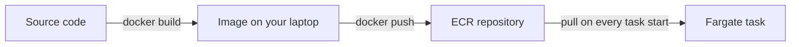

**Console:** **ECR > Create repository**, name `url-shortener`, private, defaults. Then open the repository and click **View push commands** for the commands below.

**CLI:**

```bash
aws ecr create-repository --repository-name $APP
```

**Build and push** (needed either way):

```bash
aws ecr get-login-password | docker login --username AWS --password-stdin ${ECR_URI%/*}
docker build --platform linux/amd64 -t $APP .
docker tag $APP:latest $ECR_URI:latest
docker push $ECR_URI:latest
```

- **Why `--platform linux/amd64`:** this Fargate setup runs on Intel/AMD x86 CPUs. An image built for ARM crashes with `exec format error`.
- **What `${ECR_URI%/*}` is:** the registry address without `/url-shortener` at the end; Docker logs in to the registry, not to one repository.

---

### Step 2: Secrets Manager - store the database URL

**What it is:** an encrypted store for passwords and keys.

**Why you need it:** `DATABASE_URL` contains the database password. As a plain environment variable in the task definition, anyone who can view the task definition sees it. With Secrets Manager, the task definition only holds a *reference* (an ARN), and ECS fetches the real value when the container starts.

The secret is a **key/value** secret with one key, `DATABASE_URL`. AWS stores it as JSON: `{"DATABASE_URL":"postgresql://..."}`. Step 5 tells ECS to extract that one key.

**Console:**

1. **Secrets Manager > Store a new secret > Other type of secret**.
2. Under **Key/value pairs**: key `DATABASE_URL`, value the **full URL** starting with `postgresql://` and ending with `?sslmode=no-verify`.
3. **Next**, name `prod/UrlShortener`, then **Next > Next > Store**.

**CLI:**

```bash
read -rsp "Database URL: " DB_URL; echo
SECRET_ARN=$(aws secretsmanager create-secret --name prod/UrlShortener \
  --secret-string "{\"DATABASE_URL\":\"$DB_URL\"}" \
  --query ARN --output text)
echo $SECRET_ARN
```

`read -rsp` asks for the URL without showing it on screen or saving it in your shell history.

**To change the value later:** console **Retrieve secret value > Edit**, or:

```bash
read -rsp "Database URL: " DB_URL; echo
aws secretsmanager put-secret-value --secret-id prod/UrlShortener --secret-string "{\"DATABASE_URL\":\"$DB_URL\"}"
```

Running containers keep the old value until they're replaced (see "Force new deployment" in Step 12).

---

### Step 3: Security groups - the firewalls

**Why you need them:** see "Security groups" in Part 2. Without them, either nothing can connect or everything can.

**Console:** **EC2 > Security Groups > Create security group**. Select the **same VPC as RDS** every time.

1. **`url-shortener-alb-sg`** (load balancer)
   - Inbound rule: type **HTTP**, source **Anywhere-IPv4**
   - Inbound rule: type **HTTPS**, source **Anywhere-IPv4**
2. **`url-shortener-app-sg`** (containers)
   - Inbound rule: type **Custom TCP**, port **3000**, source: type `url-shortener-alb-sg` in the search box and pick it
3. **`frontdev-rds-sg`** (database, already exists): **Edit inbound rules > Add rule**
   - Type **PostgreSQL**, source: pick **`url-shortener-app-sg`** from the search box

Leave outbound rules at the default (all traffic). Containers need outbound access to pull the image and read the secret.

**CLI:**

```bash
ALB_SG=$(aws ec2 create-security-group --group-name url-shortener-alb-sg \
  --description "url-shortener load balancer" --vpc-id $VPC_ID --query GroupId --output text)
aws ec2 authorize-security-group-ingress --group-id $ALB_SG --protocol tcp --port 80 --cidr 0.0.0.0/0
aws ec2 authorize-security-group-ingress --group-id $ALB_SG --protocol tcp --port 443 --cidr 0.0.0.0/0

APP_SG=$(aws ec2 create-security-group --group-name url-shortener-app-sg \
  --description "url-shortener containers" --vpc-id $VPC_ID --query GroupId --output text)
aws ec2 authorize-security-group-ingress --group-id $APP_SG --protocol tcp --port 3000 --source-group $ALB_SG

aws ec2 authorize-security-group-ingress --group-id $RDS_SG --protocol tcp --port 5432 --source-group $APP_SG
```

`--cidr` means "from these IPs"; `--source-group` means "from anything with this security group".

---

### Step 4: IAM - let ECS read the secret

**What it is:** Identity and Access Management. Nothing in AWS can do anything unless a policy explicitly allows it, and that includes AWS services themselves.

**Why you need it:** when a container starts, ECS downloads the image and reads the secret on your behalf. ECS needs a **role** (a set of permissions it can temporarily take on) that allows exactly that. This one is called the **task execution role**.

A role has two parts:

- **Trust policy**: *who* may use the role. Here: the ECS tasks service.
- **Permission policies**: *what* the role may do. Here: pull images, write logs, read one secret.

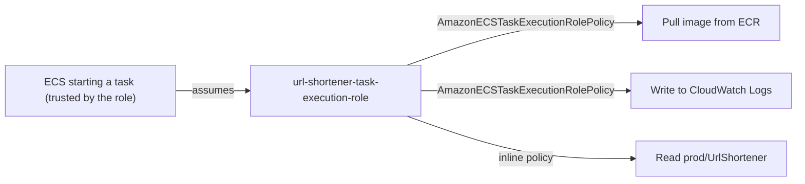

**Console:**

1. **IAM > Roles > Create role**. Trusted entity type **AWS service**, service **Elastic Container Service**, use case **Elastic Container Service Task**. This sets the trust policy. **Next**.
2. Search for and check `AmazonECSTaskExecutionRolePolicy`. **Next**.
3. Role name `url-shortener-task-execution-role`, **Create role**.
4. Open the role > **Add permissions > Create inline policy > JSON**, paste this (replace the account ID), **Next**, name `read-database-url-secret`, **Create policy**:

```json
{
  "Version": "2012-10-17",
  "Statement": [
    {
      "Effect": "Allow",
      "Action": "secretsmanager:GetSecretValue",
      "Resource": "arn:aws:secretsmanager:eu-central-1:<account-id>:secret:prod/UrlShortener-*"
    }
  ]
}
```

The `-*` matches the random 6-character suffix Secrets Manager adds to every secret ARN (like `-Cp3Q5W`).

**CLI:**

```bash
ROLE=url-shortener-task-execution-role

aws iam create-role --role-name $ROLE --assume-role-policy-document \
  '{"Version":"2012-10-17","Statement":[{"Effect":"Allow","Principal":{"Service":"ecs-tasks.amazonaws.com"},"Action":"sts:AssumeRole"}]}'

aws iam attach-role-policy --role-name $ROLE \
  --policy-arn arn:aws:iam::aws:policy/service-role/AmazonECSTaskExecutionRolePolicy

aws iam put-role-policy --role-name $ROLE --policy-name read-database-url-secret --policy-document \
  "{\"Version\":\"2012-10-17\",\"Statement\":[{\"Effect\":\"Allow\",\"Action\":\"secretsmanager:GetSecretValue\",\"Resource\":\"$SECRET_ARN\"}]}"

EXEC_ROLE_ARN=$(aws iam get-role --role-name $ROLE --query Role.Arn --output text)
```

---

### Step 5: ECS cluster and task definition

**What ECS is:** Elastic Container Service, AWS's system for running and supervising containers. It restarts crashed containers, replaces unhealthy ones, and does rolling deployments.

**What Fargate is:** the serverless way to run ECS containers. You don't manage servers; you ask for "0.5 CPU and 1 GB of memory" and AWS finds a machine.

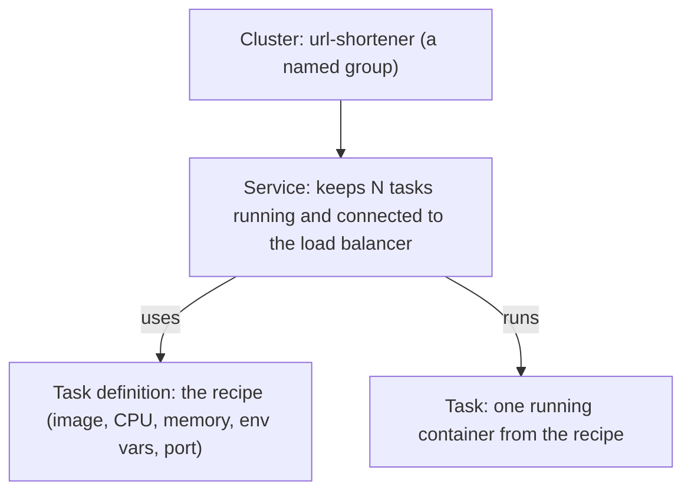

- **Task definition**: the recipe, like a `docker-compose.yaml` service entry. Every edit creates a new numbered **revision** (`url-shortener-td:1`, `:2`...).
- **Task**: one running container made from the recipe.
- **Service**: the supervisor that keeps the desired number of tasks running (Step 7).

**Console:**

1. **ECS > Clusters > Create cluster**: name `url-shortener`, infrastructure **AWS Fargate (serverless)**, **Create**.
2. **ECS > Task definitions > Create new task definition**:
   - Task definition family: `url-shortener-td`
   - Launch type **AWS Fargate**, operating system **Linux/X86_64**, CPU **.5 vCPU**, memory **1 GB**
   - Task execution role: `url-shortener-task-execution-role`
   - Container 1:
     - Name `app`, image URI `<account-id>.dkr.ecr.eu-central-1.amazonaws.com/url-shortener:latest`
     - Port mappings: container port `3000`, protocol TCP. Next.js listens on 3000 (`PORT=3000` in the [Dockerfile](Dockerfile)).
     - Environment variables, **Add environment variable**: key `DATABASE_URL`, value type **ValueFrom**, value:
       ```
       arn:aws:secretsmanager:eu-central-1:<account-id>:secret:prod/UrlShortener-Cp3Q5W:DATABASE_URL::
       ```
       (your full secret ARN, from the secret's page, plus `:DATABASE_URL::`)
     - Log collection: leave **Use log collection** checked.
   - **Create**.

**Why `:DATABASE_URL::`:** the format is `<secret-arn>:<json-key>:<version-stage>:<version-id>`. You want the `DATABASE_URL` key of the current version, so the last two parts are empty, but their colons are required.

- **Without `:DATABASE_URL::`:** the app gets the whole JSON as its URL and fails with `ENOTFOUND base`.
- **Without the final `::`:** the task fails to start with `unexpected ARN format`.

**CLI:**

```bash
aws ecs create-cluster --cluster-name $APP

# The console creates the log group automatically; with the CLI you create it yourself
aws logs create-log-group --log-group-name /ecs/url-shortener-td

aws ecs register-task-definition \
  --family url-shortener-td \
  --requires-compatibilities FARGATE --network-mode awsvpc \
  --cpu 512 --memory 1024 \
  --runtime-platform cpuArchitecture=X86_64,operatingSystemFamily=LINUX \
  --execution-role-arn "$EXEC_ROLE_ARN" \
  --container-definitions "[{
    \"name\": \"app\",
    \"image\": \"$ECR_URI:latest\",
    \"essential\": true,
    \"portMappings\": [{\"containerPort\": 3000, \"protocol\": \"tcp\"}],
    \"secrets\": [{\"name\": \"DATABASE_URL\", \"valueFrom\": \"$SECRET_ARN:DATABASE_URL::\"}],
    \"logConfiguration\": {\"logDriver\": \"awslogs\", \"options\": {
      \"awslogs-group\": \"/ecs/url-shortener-td\",
      \"awslogs-region\": \"$AWS_DEFAULT_REGION\",
      \"awslogs-stream-prefix\": \"ecs\"
    }}
  }]"
```

- `--cpu 512` is 0.5 vCPU (1024 = 1 vCPU) and `--memory 1024` is 1 GB.
- `--network-mode awsvpc` gives each task its own private IP, which Fargate requires.
- The console's "ValueFrom" environment variables are stored in the `secrets` field.

---

### Step 6: Target group and load balancer

**What a load balancer is:** the public front door. It has a stable address, accepts browser requests, and forwards each one to a healthy container.

**Why you need it:**

- Containers get a new IP every time they restart. The load balancer's address never changes.
- It runs **health checks** and stops sending traffic to broken containers.
- It spreads traffic when you run more than one container.
- It handles HTTPS (Step 11), so the app doesn't have to.

Three parts:

- **Listener**: a port the load balancer accepts connections on (80, later 443), and what to do with them (forward or redirect).
- **Target group**: the list of containers to forward to. ECS adds each new task's IP and removes stopped ones automatically.
- **Health check**: the load balancer requests `/` on each target every 30 seconds; two successes in a row make it **Healthy**.

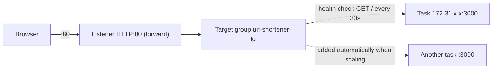

**Console:**

1. **EC2 > Target groups > Create target group**:
   - Target type **IP addresses** (Fargate tasks are identified by IP)
   - Name `url-shortener-tg`, protocol **HTTP**, port **3000**, same VPC
   - Health check path `/`; under **Advanced health check settings**, success codes `200-399`
   - **Next**. On **Register targets**, add nothing (ECS does it). **Create target group**.
2. **EC2 > Load balancers > Create load balancer > Application Load Balancer > Create**:
   - Name `url-shortener-alb`, scheme **Internet-facing**, IP address type **IPv4**
   - Network mapping: same VPC; check **all three** Availability Zones (each has one public subnet)
   - Security groups: remove `default`, select `url-shortener-alb-sg`
   - Listeners and routing: protocol **HTTP**, port **80**, default action **Forward to** `url-shortener-tg`
   - **Create load balancer**

**CLI:**

```bash
TG_ARN=$(aws elbv2 create-target-group --name url-shortener-tg \
  --protocol HTTP --port 3000 --vpc-id $VPC_ID --target-type ip \
  --health-check-path / --matcher HttpCode=200-399 \
  --query "TargetGroups[0].TargetGroupArn" --output text)

ALB_ARN=$(aws elbv2 create-load-balancer --name $ALB_NAME \
  --type application --scheme internet-facing \
  --subnets ${SUBNETS_CSV//,/ } --security-groups $ALB_SG \
  --query "LoadBalancers[0].LoadBalancerArn" --output text)

aws elbv2 create-listener --load-balancer-arn $ALB_ARN \
  --protocol HTTP --port 80 \
  --default-actions Type=forward,TargetGroupArn=$TG_ARN
```

`${SUBNETS_CSV//,/ }` turns the comma-separated subnet list into a space-separated one, which `--subnets` expects.

---

### Step 7: Create the ECS service

**Why you need it:** a task definition is only a recipe; nothing runs yet. The service starts tasks from it, registers them in the target group, replaces any that crash or fail health checks, and does zero-downtime updates.

**Console:** everything below is **one form**: **ECS > Clusters > `url-shortener` > Services tab > Create**. Fill the sections top to bottom, then click **Create**.

1. **Service details**: task definition family `url-shortener-td`, revision latest. Service name `url-shortener-service`.
2. **Compute configuration**: compute options **Launch type**, launch type **FARGATE**, platform version **LATEST**.
3. **Deployment configuration**: service type **Replica**, desired tasks `1`. Health check grace period `60`.
4. **Networking**: same VPC, all three subnets. Security group: **Use an existing security group**, remove `default`, select `url-shortener-app-sg`. **Public IP: turned on**.
5. **Load balancing**: check **Use load balancing**, type **Application Load Balancer**, container `app 3000:3000`. **Use an existing load balancer**: `url-shortener-alb`. **Use an existing listener**: `80:HTTP`. **Use an existing target group**: `url-shortener-tg`.

**CLI:**

```bash
SERVICE=url-shortener-service

aws ecs create-service --cluster $APP --service-name $SERVICE \
  --task-definition url-shortener-td --desired-count 1 --launch-type FARGATE \
  --health-check-grace-period-seconds 60 \
  --network-configuration "awsvpcConfiguration={subnets=[$SUBNETS_CSV],securityGroups=[$APP_SG],assignPublicIp=ENABLED}" \
  --load-balancers "targetGroupArn=$TG_ARN,containerName=app,containerPort=3000"
```

- **Why Public IP must be on:** the task has to reach ECR and Secrets Manager, which are on the public AWS network. In a public subnet that only works with a public IP. It's still not reachable from the internet: `url-shortener-app-sg` only accepts the load balancer.
- **Why the 60-second grace period:** the load balancer's health checks are ignored for the first 60 seconds, so a container that's still starting isn't killed as unhealthy.
- **Desired tasks:** `1` is enough to start. `2` keeps the app up if one AZ fails, and doubles the Fargate cost.

---

### Step 8: Watch it start (2-5 minutes)

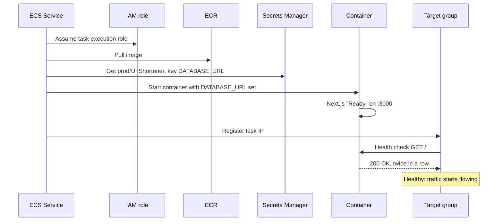

**Console:**

1. **ECS > Clusters > `url-shortener` > your service**:
   - **Deployments** tab: ends with **Completed**. **Failed** means tasks keep crashing.
   - **Tasks** tab: **Provisioning > Pending > Running**. If a task shows **Stopped**, click it and read **Stopped reason** at the top.
   - **Events** tab: ends with "has reached a steady state".
2. **EC2 > Target groups > `url-shortener-tg` > Targets**: the task IP goes **Initial > Healthy**. **Healthy is the real "it works" signal.**
3. **Logs**: on the task, the **Logs** tab, or **CloudWatch > Log groups > `/ecs/url-shortener-td`**. A good start shows `Ready in ...ms`.

**CLI:**

```bash
# Blocks until the service is stable (or fails after ~10 minutes)
aws ecs wait services-stable --cluster $APP --services $SERVICE

# Latest service events
aws ecs describe-services --cluster $APP --services $SERVICE --query "services[0].events[:5].message" --output table

# Target health
aws elbv2 describe-target-health --target-group-arn $TG_ARN \
  --query "TargetHealthDescriptions[].[Target.Id,TargetHealth.State,TargetHealth.Reason]" --output table

# Live container logs (Ctrl+C to stop)
aws logs tail /ecs/url-shortener-td --follow --since 10m
```

---

### Step 9: Open and test the app

Until Step 11 the app is only on the load balancer's own address, over plain HTTP.

1. Get the address: **EC2 > Load balancers > `url-shortener-alb` > Details > DNS name**, or:

   ```bash
   aws elbv2 describe-load-balancers --load-balancer-arns $ALB_ARN --query "LoadBalancers[0].DNSName" --output text
   ```

2. Open `http://<dns-name>` (not `https://`).
3. Submit a full URL **including** `https://`, for example `https://example.com`. Without it, the redirect goes to a page on your own site.
4. The form doesn't show the short link yet. Find the ID in the database:

   ```bash
   psql "postgresql://<user>:<password>@<endpoint>:5432/<db>?sslmode=require" -c "select short_url, original_url from links order by 1 desc limit 5;"
   ```

   `short_url` looks like `https://shor.ty/<uuid>`.
5. Open `http://<dns-name>/<uuid>`. You should land on `example.com`.

**Known gap in the code:** `https://shor.ty` is hardcoded in [src/app/_components/form/createLink.action.ts](src/app/_components/form/createLink.action.ts) and [src/app/[id]/page.tsx](src/app/[id]/page.tsx). Redirects work because the lookup only uses the ID, but stored links point to a domain you don't own. Move the base URL into an env var (`APP_BASE_URL`) and store only the ID.

---

### Step 10: Troubleshooting

Find the problem in this order:

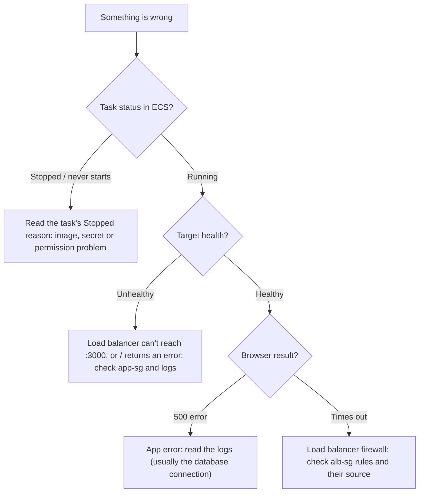

Diagnostic commands:

```bash
# Why did the last task stop?
LAST_TASK=$(aws ecs list-tasks --cluster $APP --desired-status STOPPED --query "taskArns[0]" --output text)
aws ecs describe-tasks --cluster $APP --tasks $LAST_TASK --query "tasks[0].[stoppedReason,containers[0].reason]" --output text

# Target health
aws elbv2 describe-target-health --target-group-arn $TG_ARN --query "TargetHealthDescriptions[].[Target.Id,TargetHealth.State,TargetHealth.Reason]" --output table

# Recent errors in the logs
aws logs tail /ecs/url-shortener-td --since 30m | grep -iE "error|refused|timeout" | tail -20

# Load balancer firewall rules: 80 and 443 must have 0.0.0.0/0 as the source
aws ec2 describe-security-groups --group-ids $ALB_SG --query "SecurityGroups[0].IpPermissions[].[FromPort,IpRanges[0].CidrIp,UserIdGroupPairs[0].GroupId]" --output table
```

| Symptom | Cause | Fix |
| --- | --- | --- |
| Task stopped: `CannotPullContainerError` | Wrong image URI, or no internet route | Check the image URI; Public IP must be on |
| Task stopped: `ResourceInitializationError ... secrets` | Role can't read the secret, or no internet route | Check the inline policy (Step 4); Public IP on |
| Task stopped: `unexpected ARN format with parameters` | `ValueFrom` missing the trailing `::` | Use `<secret-arn>:DATABASE_URL::` |
| Logs: `exec format error` | Image built for ARM | Rebuild with `--platform linux/amd64` |
| Logs: `getaddrinfo ENOTFOUND base` | `DATABASE_URL` isn't a valid URL: the whole JSON was passed, or the stored value isn't a full `postgresql://...` URL | Use the `:DATABASE_URL::` suffix and store the full URL |
| Logs: `ECONNREFUSED` or timeout to RDS | RDS security group doesn't allow `url-shortener-app-sg` | Add inbound 5432 from `url-shortener-app-sg` |
| Logs: `no pg_hba.conf entry ... no encryption` | Connecting without SSL | Add `?sslmode=no-verify` to the URL in the secret |
| Target **Unhealthy** | Load balancer can't reach port 3000, or `/` errors | `url-shortener-app-sg` must allow 3000 from `url-shortener-alb-sg`; check logs |
| Browser **503** | No healthy targets | Wait, or see the rows above |
| Browser **504** | Target not responding | Same as Unhealthy |
| Browser times out on `https://` | Port 443 rule missing, or its source is a security group instead of `0.0.0.0/0` | Fix the rule in `url-shortener-alb-sg` (Step 3) |
| `psql` / migrations time out from your laptop | Your home IP changed | Re-run the IP rule from Step 0 |

**Running tasks never pick up changes on their own.** After changing the secret or the task definition, force a new deployment (Step 12).

---

### Step 11: Domain and HTTPS

**Why:** browsers mark plain HTTP as "Not secure", and nobody wants to share links on `url-shortener-alb-1234567890.eu-central-1.elb.amazonaws.com`. You need:

- **A domain** registered in **Route 53**, AWS's domain registrar and DNS service.
- **A certificate** from **ACM (AWS Certificate Manager)**, free and auto-renewing, attached to the load balancer.

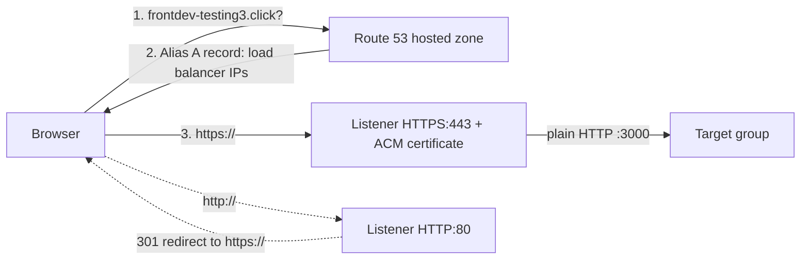

HTTPS ends at the load balancer: it decrypts the request and forwards plain HTTP to the container inside the VPC. The app needs no changes.

Route 53 terms:

- **Registered domain**: the domain you bought. Its settings point at name servers that answer DNS questions about it.
- **Hosted zone**: the list of DNS records for the domain (what `frontdev-testing3.click` resolves to). Created automatically when you buy the domain in Route 53, for $0.50 a month.
- **Record**: one entry in the hosted zone, like "`frontdev-testing3.click` is the load balancer".

#### 11.1 Register the domain

**Console:** **Route 53 > Domains > Registered domains > Register domains**. Search for a name, add it to the cart, fill in contact details, and pay. Registration takes 5-15 minutes; you'll get an email to verify your contact address (do it, or the domain gets suspended after 15 days).

**CLI:** checking availability is easy; registration itself needs full contact details, so use the console for that.

```bash
# Route 53 Domains only exists in us-east-1, whatever region you use for everything else
aws route53domains check-domain-availability --region us-east-1 --domain-name $DOMAIN
```

Once registered, get the hosted zone ID, which the CLI commands below need:

```bash
ZONE_ID=$(aws route53 list-hosted-zones-by-name --dns-name $DOMAIN --query "HostedZones[0].Id" --output text)
echo $ZONE_ID
```

#### 11.2 Request the certificate

The certificate must be in the **same region as the load balancer** (`eu-central-1`), or the load balancer can't use it.

**Console:**

1. With the region on **Europe (Frankfurt)**, open **Certificate Manager**.
2. **Request a certificate > Request a public certificate > Next**.
3. Fully qualified domain name: `frontdev-testing3.click`. Validation method **DNS validation**, key algorithm **RSA 2048**. **Request**.

**CLI:**

```bash
CERT_ARN=$(aws acm request-certificate --domain-name $DOMAIN --validation-method DNS --query CertificateArn --output text)
echo $CERT_ARN
```

#### 11.3 Prove you own the domain

Before issuing the certificate, ACM checks that you control the domain: it asks you to create a specific CNAME record in the domain's DNS, then looks for it. Only the domain owner can do that.

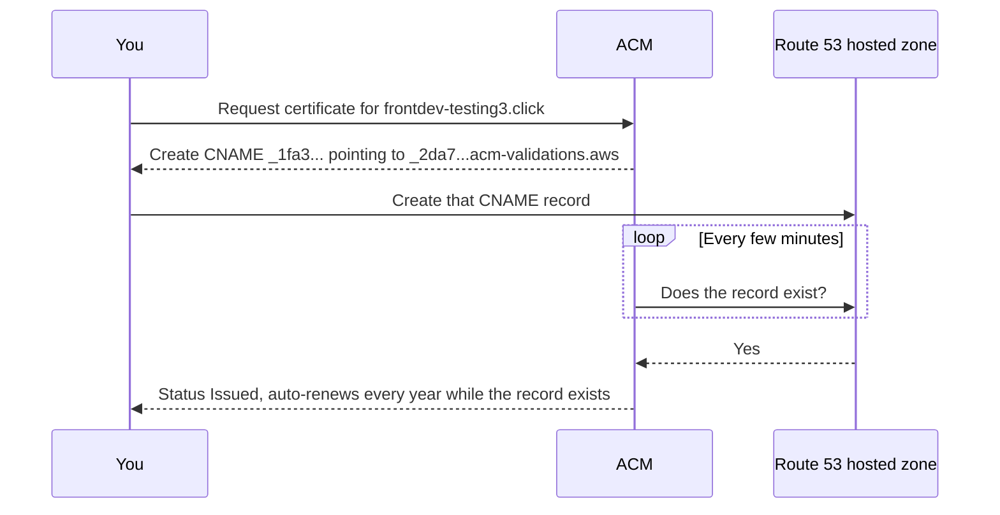

**Console:**

1. **Certificate Manager > List certificates**, click the certificate (status **Pending validation**).
2. In the **Domains** section, click **Create records in Route 53**, check the domain, **Create records**.
3. Wait until the status is **Issued** (usually 5-30 minutes; refresh the page).

**CLI:**

```bash
sleep 10   # ACM needs a few seconds to generate the record after the request

read VAL_NAME VAL_VALUE < <(aws acm describe-certificate --certificate-arn $CERT_ARN \
  --query "Certificate.DomainValidationOptions[0].ResourceRecord.[Name,Value]" --output text)

aws route53 change-resource-record-sets --hosted-zone-id $ZONE_ID --change-batch "{
  \"Changes\": [{\"Action\": \"UPSERT\", \"ResourceRecordSet\": {
    \"Name\": \"$VAL_NAME\", \"Type\": \"CNAME\", \"TTL\": 300,
    \"ResourceRecords\": [{\"Value\": \"$VAL_VALUE\"}]
  }}]
}"

# Blocks until the certificate is Issued
aws acm wait certificate-validated --certificate-arn $CERT_ARN
```

**Never delete this CNAME record.** ACM checks it again every year to renew the certificate automatically.

#### 11.4 Make sure port 443 is open

If you created `url-shortener-alb-sg` with both rules in Step 3, skip this. Otherwise:

**Console:** **EC2 > Security Groups > `url-shortener-alb-sg` > Inbound rules > Edit inbound rules > Add rule**: type **HTTPS**, source **Anywhere-IPv4**. **Save rules**.

Pick **Anywhere-IPv4** from the source dropdown; don't pick a security group from the search box. A security group as the source blocks every browser.

**CLI:**

```bash
aws ec2 authorize-security-group-ingress --group-id $ALB_SG --protocol tcp --port 443 --cidr 0.0.0.0/0
```

#### 11.5 Add the HTTPS listener

**Console:**

1. **EC2 > Load balancers > `url-shortener-alb` > Listeners and rules > Add listener**.
2. Protocol **HTTPS**, port **443**.
3. Routing action **Forward to target groups**: `url-shortener-tg`.
4. Secure listener settings: security policy, leave the recommended default. Default SSL/TLS server certificate: **From ACM**, select `frontdev-testing3.click`.
5. **Add**.

If the certificate isn't in the dropdown, it's not **Issued** yet or it's in another region.

**CLI:**

```bash
aws elbv2 create-listener --load-balancer-arn $ALB_ARN \
  --protocol HTTPS --port 443 \
  --certificates CertificateArn=$CERT_ARN \
  --ssl-policy ELBSecurityPolicy-TLS13-1-2-2021-06 \
  --default-actions Type=forward,TargetGroupArn=$TG_ARN
```

The security policy decides which TLS (encryption protocol) versions browsers may use; this one allows only the modern, secure TLS 1.2 and 1.3.

#### 11.6 Point the domain at the load balancer

Create an **Alias A record**: a Route 53 feature that says "this name resolves to whatever IPs that AWS resource has right now". The load balancer's IPs change over time, so never use a normal A record with its current IPs.

**Console:**

1. **Route 53 > Hosted zones > `frontdev-testing3.click` > Create record**.
2. Record name: leave **empty** (the bare domain). Record type **A**.
3. Turn on **Alias**. Route traffic to **Alias to Application and Classic Load Balancer**, region **Europe (Frankfurt)**, then pick `dualstack.url-shortener-alb-...`.
4. **Create records**.

**CLI:**

```bash
read ALB_DNS ALB_ZONE < <(aws elbv2 describe-load-balancers --load-balancer-arns $ALB_ARN \
  --query "LoadBalancers[0].[DNSName,CanonicalHostedZoneId]" --output text)

aws route53 change-resource-record-sets --hosted-zone-id $ZONE_ID --change-batch "{
  \"Changes\": [{\"Action\": \"UPSERT\", \"ResourceRecordSet\": {
    \"Name\": \"$DOMAIN\", \"Type\": \"A\",
    \"AliasTarget\": {\"HostedZoneId\": \"$ALB_ZONE\", \"DNSName\": \"dualstack.$ALB_DNS\", \"EvaluateTargetHealth\": true}
  }}]
}"
```

`ALB_ZONE` is the load balancer's own hosted zone ID (one per region, managed by AWS), not your domain's. Route 53 needs it to find the load balancer.

**Check** (DNS changes take a few minutes to spread):

```bash
nslookup $DOMAIN
curl -I https://$DOMAIN
```

`nslookup` should return 2-3 IPs, and `curl` an HTTP status line like `HTTP/1.1 200 OK`. Then open `https://frontdev-testing3.click`: you should see the app with a padlock.

#### 11.7 Redirect HTTP to HTTPS

`http://frontdev-testing3.click` still serves the app unencrypted. Make it redirect.

**Console:**

1. **EC2 > Load balancers > `url-shortener-alb` > Listeners and rules**, select **HTTP:80**, **Manage listener > Edit listener**.
2. Routing action **Redirect to URL**. **URI parts**: protocol **HTTPS**, port **443**. Leave host, path and query as they are. Status code **301 - Permanently moved**.
3. **Save changes**.

**CLI:**

```bash
HTTP_LISTENER=$(aws elbv2 describe-listeners --load-balancer-arn $ALB_ARN --query 'Listeners[?Port==`80`].ListenerArn' --output text)

aws elbv2 modify-listener --listener-arn $HTTP_LISTENER \
  --default-actions 'Type=redirect,RedirectConfig={Protocol=HTTPS,Port=443,StatusCode=HTTP_301}'
```

**Check:** `curl -I http://$DOMAIN` should return `301 Moved Permanently` with a `Location:` header starting with `https://frontdev-testing3.click`.

#### 11.8 Tell the app its address

Once the hardcoded `https://shor.ty` is replaced with an `APP_BASE_URL` env var (Step 9):

**Console:** **ECS > Task definitions > `url-shortener-td`**, select the latest revision, **Create new revision**. In the `app` container, add an environment variable: key `APP_BASE_URL`, value type **Value**, value `https://frontdev-testing3.click`. **Create**, then deploy it (Step 12).

It isn't secret, so a plain environment variable is fine; it doesn't belong in Secrets Manager.

#### Step 11 troubleshooting

| Symptom | Cause | Fix |
| --- | --- | --- |
| Certificate stays **Pending validation** over an hour | Validation record missing | Certificate page > **Create records in Route 53** again |
| Certificate missing from the listener dropdown | Not **Issued** yet, or in another region | Wait, or request it again in Frankfurt |
| `https://` times out | No 443 rule on `url-shortener-alb-sg`, its source isn't `0.0.0.0/0`, or no HTTPS listener | 11.4 and 11.5 |
| Browser: `NET::ERR_CERT_COMMON_NAME_INVALID` | You opened the load balancer's own DNS name over `https://` | Use `https://frontdev-testing3.click` |
| `nslookup` finds nothing | Alias record missing, or still spreading | Check the record in the hosted zone; wait 5-10 minutes |

---

### Step 12: Deploying new versions

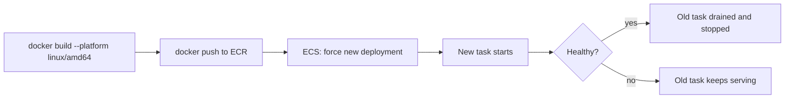

ECS starts the new task first and only stops the old one once the new one is healthy (a **rolling deployment**), so there's no downtime and a broken build never replaces a working one.

**New code:**

```bash
aws ecr get-login-password | docker login --username AWS --password-stdin ${ECR_URI%/*}
docker build --platform linux/amd64 -t $APP .
docker tag $APP:latest $ECR_URI:latest
docker push $ECR_URI:latest

aws ecs update-service --cluster $APP --service $SERVICE --force-new-deployment
aws ecs wait services-stable --cluster $APP --services $SERVICE
```

Console equivalent of the last two commands: **ECS > service > Update**, check **Force new deployment**, **Update**.

**New secret value:** same `update-service --force-new-deployment` command; containers read secrets only at startup.

**New task definition revision:** point the service at it. Without a revision number, ECS uses the latest:

```bash
aws ecs update-service --cluster $APP --service $SERVICE --task-definition url-shortener-td
```

#### Automatic deploys from GitHub

Every push (or merged pull request) to `master` deploys automatically through [.github/workflows/ci.yaml](.github/workflows/ci.yaml). The manual commands above are only needed if GitHub Actions is down.

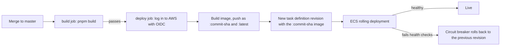

- **No AWS keys in GitHub.** GitHub proves to AWS which repo and branch is running the workflow (OIDC). AWS lets only `krzysztofkaptur/url-shortener-next` on `master` use the role `url-shortener-github-deploy`, and that role can only push to the `url-shortener` repository and update this one service.
- **Every release is its own image.** Images are tagged with the commit SHA, and each deploy creates a new task definition revision pointing at it. To roll back by hand: **ECS > service > Update**, pick the previous revision, **Update**.
- **Broken releases roll back automatically.** The service's deployment circuit breaker is on with rollback: if new tasks keep failing, ECS returns to the last working revision and the GitHub job fails.
- **Pull requests only build.** The deploy job runs only on `master`.

One-time GitHub setup (already done for this repo):

1. **AWS**: an IAM identity provider for `token.actions.githubusercontent.com` (audience `sts.amazonaws.com`), and the role `url-shortener-github-deploy`, which trusts it for `repo:krzysztofkaptur@12236873/url-shortener-next@1451761738:ref:refs/heads/master`. The numbers are GitHub's permanent owner and repo IDs, included because this account customizes the OIDC subject claim.
2. **GitHub > repo > Settings > Secrets and variables > Actions > New repository secret**:
   - `DOCKER_USERNAME`: your Docker Hub username
   - `DOCKER_TOKEN`: a Docker Hub personal access token (**Docker Hub > Account settings > Personal access tokens > Generate new token**, access **Read-only**). The build needs it to pull the `dhi.io` base images.

To watch a deploy: **GitHub > repo > Actions**, open the latest run. The **Deploy to ECS** step stays running until the new task is healthy (usually 3-5 minutes).

---

### Step 13 (last): Secure the database

Right now the database has a public IP, accepts connections from your laptop, the app uses the master user, and SSL doesn't verify the server's identity.

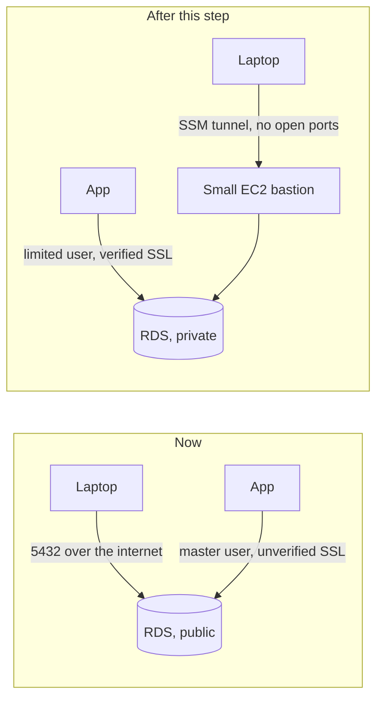

Do 13.1 first: once the database is private, your laptop can only reach it through the tunnel.

#### 13.1 Set up admin access through a tunnel

**Why:** after 13.2, the database is unreachable from the internet, including your laptop. A **bastion** is a tiny server inside the VPC that you tunnel through. **SSM Session Manager** opens the tunnel through AWS itself, so the bastion needs no SSH keys and no open inbound ports.

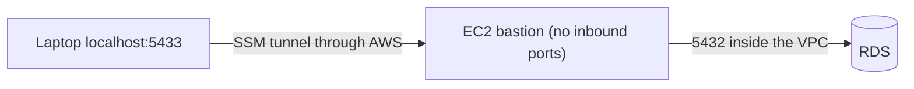

1. Install the [Session Manager plugin](https://docs.aws.amazon.com/systems-manager/latest/userguide/session-manager-working-with-install-plugin.html) for the AWS CLI.
2. Create the bastion (role, security group, instance):

   ```bash
   # Role that lets the instance talk to SSM
   aws iam create-role --role-name url-shortener-bastion-role --assume-role-policy-document \
     '{"Version":"2012-10-17","Statement":[{"Effect":"Allow","Principal":{"Service":"ec2.amazonaws.com"},"Action":"sts:AssumeRole"}]}'
   aws iam attach-role-policy --role-name url-shortener-bastion-role \
     --policy-arn arn:aws:iam::aws:policy/AmazonSSMManagedInstanceCore
   aws iam create-instance-profile --instance-profile-name url-shortener-bastion
   aws iam add-role-to-instance-profile --instance-profile-name url-shortener-bastion --role-name url-shortener-bastion-role

   # Security group with no inbound rules, allowed into the database
   BASTION_SG=$(aws ec2 create-security-group --group-name url-shortener-bastion-sg \
     --description "url-shortener SSM bastion" --vpc-id $VPC_ID --query GroupId --output text)
   aws ec2 authorize-security-group-ingress --group-id $RDS_SG --protocol tcp --port 5432 --source-group $BASTION_SG

   # Smallest Amazon Linux instance, in a public subnet so it can reach SSM
   sleep 10   # new instance profiles take a few seconds to become usable
   BASTION_ID=$(aws ec2 run-instances \
     --image-id resolve:ssm:/aws/service/ami-amazon-linux-latest/al2023-ami-kernel-default-x86_64 \
     --instance-type t3.micro --subnet-id ${SUBNETS_CSV%%,*} \
     --security-group-ids $BASTION_SG --associate-public-ip-address \
     --iam-instance-profile Name=url-shortener-bastion \
     --tag-specifications 'ResourceType=instance,Tags=[{Key=Name,Value=url-shortener-bastion}]' \
     --query "Instances[0].InstanceId" --output text)
   ```

3. Open the tunnel (keep this terminal open while you work):

   ```bash
   RDS_HOST=$(aws rds describe-db-instances --db-instance-identifier $RDS_ID --query "DBInstances[0].Endpoint.Address" --output text)
   aws ssm start-session --target $BASTION_ID \
     --document-name AWS-StartPortForwardingSessionToRemoteHost \
     --parameters "host=$RDS_HOST,portNumber=5432,localPortNumber=5433"
   ```

4. In another terminal, connect to `localhost:5433` instead of the RDS endpoint:

   ```bash
   psql "postgresql://<user>:<password>@localhost:5433/<db>?sslmode=require"
   ```

   For migrations and Drizzle Studio, use `localhost:5433` in `.env` the same way.

The bastion costs about $8 a month while running. Stop it when you don't need it, and start it again before opening a tunnel:

```bash
aws ec2 stop-instances --instance-ids $BASTION_ID
aws ec2 start-instances --instance-ids $BASTION_ID
```

#### 13.2 Make the database private

**Why:** a database reachable from the internet can be attacked from the internet. Only the app and the bastion should reach it.

**Console:**

1. **RDS > Databases > `url-shortener` > Modify > Connectivity > Additional configuration**: **Not publicly accessible**. **Continue**, **Apply immediately**, **Modify DB instance**.
2. **EC2 > Security Groups > `frontdev-rds-sg` > Edit inbound rules**: delete every rule with an IP address as the source. Keep the rules whose source is `url-shortener-app-sg`, `url-shortener-bastion-sg`, and any other app's security group that uses this database (such as `frontdev-ecs-sg`).

**CLI:**

```bash
aws rds modify-db-instance --db-instance-identifier $RDS_ID --no-publicly-accessible --apply-immediately

# List the IP-based rules, then remove each one
aws ec2 describe-security-groups --group-ids $RDS_SG --query "SecurityGroups[0].IpPermissions[].IpRanges[].CidrIp" --output text
aws ec2 revoke-security-group-ingress --group-id $RDS_SG --protocol tcp --port 5432 --cidr <ip>/32
```

#### 13.3 Give the app its own limited database user

**Why:** the app currently uses the master user, which can drop databases and create users. If the app is ever compromised, a limited user can only read and write the app's tables.

1. Through the tunnel, run as the master user (pick a strong password):

   ```sql
   CREATE ROLE url_shortener_app LOGIN PASSWORD '<strong-password>';
   GRANT CONNECT ON DATABASE postgres TO url_shortener_app;
   GRANT USAGE ON SCHEMA public TO url_shortener_app;
   GRANT SELECT, INSERT, UPDATE, DELETE ON ALL TABLES IN SCHEMA public TO url_shortener_app;
   GRANT USAGE, SELECT ON ALL SEQUENCES IN SCHEMA public TO url_shortener_app;
   -- Tables created later by migrations (run as the master user) get the same permissions
   ALTER DEFAULT PRIVILEGES IN SCHEMA public GRANT SELECT, INSERT, UPDATE, DELETE ON TABLES TO url_shortener_app;
   ALTER DEFAULT PRIVILEGES IN SCHEMA public GRANT USAGE, SELECT ON SEQUENCES TO url_shortener_app;
   ```

2. Put the new user in the secret and redeploy:

   ```bash
   read -rsp "Database URL: " DB_URL; echo   # postgresql://url_shortener_app:<strong-password>@<endpoint>:5432/postgres?sslmode=no-verify
   aws secretsmanager put-secret-value --secret-id prod/UrlShortener --secret-string "{\"DATABASE_URL\":\"$DB_URL\"}"
   aws ecs update-service --cluster $APP --service $SERVICE --force-new-deployment
   ```

Keep running migrations as the master user through the tunnel; the app user can't change table structure.

#### 13.4 Replace the master password

**Why:** the current master password has been pasted in chats and terminals. Letting RDS manage it in Secrets Manager generates a new random one you never need to see.

**Console:** **RDS > Databases > `url-shortener` > Modify > Credentials management**: **Managed in AWS Secrets Manager**. **Continue**, **Apply immediately**.

**CLI:**

```bash
aws rds modify-db-instance --db-instance-identifier $RDS_ID --manage-master-user-password --apply-immediately
```

To get the master password later: **Secrets Manager**, the secret named `rds!db-...`, **Retrieve secret value**.

#### 13.5 Verify the database's certificate

**Why:** `sslmode=no-verify` encrypts traffic but doesn't prove you're talking to your real database. Full verification needs Node to trust Amazon's database certificate authority.

This is a code change:

1. Download the CA bundle into the project:

   ```bash
   mkdir -p certs && curl -o certs/rds-global-bundle.pem https://truststore.pki.rds.amazonaws.com/global/global-bundle.pem
   ```

2. In the `runner` stage of the [Dockerfile](Dockerfile), copy it and tell Node to trust it:

   ```dockerfile
   COPY --chown=node:node certs/rds-global-bundle.pem ./certs/
   ENV NODE_EXTRA_CA_CERTS=/app/certs/rds-global-bundle.pem
   ```

3. In the secret, change `?sslmode=no-verify` to `?sslmode=verify-full`, then rebuild, push and redeploy (Step 12).

#### 13.6 Backups and deletion protection

**Why:** backups let you restore after a bad migration; deletion protection stops the database being deleted by one wrong click.

**Console:** **RDS > Databases > `url-shortener` > Modify**: backup retention period **7 days**, check **Enable deletion protection**. **Continue**, **Apply immediately**.

**CLI:**

```bash
aws rds modify-db-instance --db-instance-identifier $RDS_ID \
  --backup-retention-period 7 --deletion-protection --apply-immediately

# Encryption can only be chosen when a database is created; check it's on
aws rds describe-db-instances --db-instance-identifier $RDS_ID --query "DBInstances[0].StorageEncrypted"
```

If `StorageEncrypted` is `false`, the fix is to take a snapshot, copy it with encryption enabled, and restore a new database from the copy.

---

## Cost (approximate, per month)

| Item | Cost |
| --- | --- |
| Application Load Balancer | $16-20 |
| Fargate, 0.5 vCPU / 1 GB, 1 task 24/7 | ~$18 |
| Public IPv4 addresses (load balancer uses 3, each task 1) | ~$3.60 each |
| RDS | depends on instance size (free tier eligible for 12 months on small instances) |
| Route 53 hosted zone | $0.50, plus the yearly domain price |
| Bastion (Step 13), only while running | ~$8 |
| ECR, Secrets Manager, CloudWatch | under $2 at this scale |

To pause the app, set desired tasks to `0`:

```bash
aws ecs update-service --cluster $APP --service $SERVICE --desired-count 0
```

The load balancer keeps costing money until you delete it.

---

## Appendix A: Look up existing resources

After the session block in Part 3, this fills in the remaining variables for resources that already exist:

```bash
SECRET_ARN=$(aws secretsmanager describe-secret --secret-id prod/UrlShortener --query ARN --output text)
ALB_SG=$(aws ec2 describe-security-groups --filters Name=vpc-id,Values=$VPC_ID Name=group-name,Values=url-shortener-alb-sg --query "SecurityGroups[0].GroupId" --output text)
APP_SG=$(aws ec2 describe-security-groups --filters Name=vpc-id,Values=$VPC_ID Name=group-name,Values=url-shortener-app-sg --query "SecurityGroups[0].GroupId" --output text)
EXEC_ROLE_ARN=$(aws iam get-role --role-name url-shortener-task-execution-role --query Role.Arn --output text)
TG_ARN=$(aws elbv2 describe-target-groups --names url-shortener-tg --query "TargetGroups[0].TargetGroupArn" --output text)
ALB_ARN=$(aws elbv2 describe-load-balancers --names $ALB_NAME --query "LoadBalancers[0].LoadBalancerArn" --output text)
SERVICE=$(aws ecs list-services --cluster $APP --query "serviceArns[0]" --output text)
ZONE_ID=$(aws route53 list-hosted-zones-by-name --dns-name $DOMAIN --query "HostedZones[0].Id" --output text)
CERT_ARN=$(aws acm list-certificates --query "CertificateSummaryList[?DomainName=='$DOMAIN'].CertificateArn | [0]" --output text)
BASTION_ID=$(aws ec2 describe-instances --filters Name=tag:Name,Values=url-shortener-bastion Name=instance-state-name,Values=running,stopped --query "Reservations[0].Instances[0].InstanceId" --output text)
```

A variable that prints `None` (or an error) means that resource doesn't exist yet.

---

## Glossary

| Term | Meaning |
| --- | --- |
| **ALB** | Application Load Balancer: the public HTTP(S) entry point |
| **Alias record** | A Route 53 record that always resolves to an AWS resource's current IPs |
| **ARN** | Amazon Resource Name: a unique ID for any AWS resource |
| **AZ** | Availability Zone: a separate data center within a region |
| **Bastion** | A small server inside the VPC used only as a way in for admins |
| **CIDR** | IP range notation: `/32` is one address, `/16` is 65,536, `0.0.0.0/0` is everything |
| **ECR** | Elastic Container Registry: private image storage |
| **ECS** | Elastic Container Service: runs and supervises containers |
| **Fargate** | Runs ECS containers without managing servers |
| **Hosted zone** | The set of DNS records for a domain in Route 53 |
| **IAM role** | A set of permissions a service (or person) can temporarily take on |
| **Internet Gateway** | Connects a VPC to the internet; makes a subnet "public" |
| **Listener** | A port the load balancer accepts connections on, plus what to do with them |
| **NAT Gateway** | Lets private subnets reach the internet without being reachable |
| **RDS** | Relational Database Service: managed Postgres/MySQL |
| **Revision** | A numbered version of a task definition |
| **Security group** | A firewall around a resource, allowing specific inbound traffic |
| **SSM Session Manager** | Opens shells and tunnels to EC2 instances through AWS, without open ports |
| **Subnet** | A slice of a VPC's address range in one AZ |
| **Target group** | The list of containers a load balancer sends traffic to |
| **Task** | One running container started by ECS |
| **Task definition** | The recipe for a task: image, CPU, memory, ports, env vars |
| **Task execution role** | The IAM role ECS uses to pull images, read secrets and write logs |
| **Trust policy** | The part of an IAM role that says who may use it |
| **VPC** | Virtual Private Cloud: your private network in AWS |
